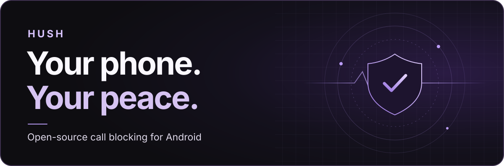
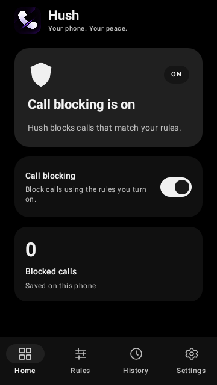
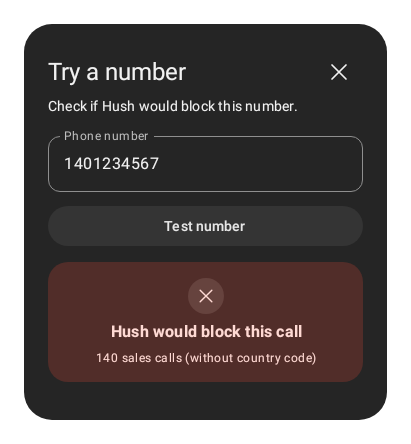
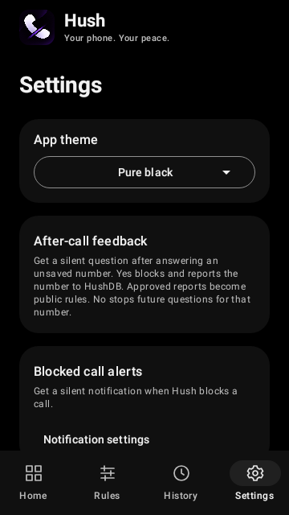

<h1 align="center">
  
</h1>

  <strong><a href="https://github.com/arpan-mandal/hush/releases/latest">Download Hush</a></strong>
  · <a href="https://hush.arpanm.xyz/">Website</a>
  · <a href="https://hush.arpanm.xyz/docs">Setup guide</a>
  · <a href="https://hushdb.arpanm.xyz/rules">Cloud rules</a>

<strong>Android 10+</strong> · <strong>Works offline</strong> · <strong>Free and open source</strong>

Hush screens eligible incoming calls before they ring. It comes with rules for India’s 140 sales numbers, lets you add your own, and shows what it declined and why. Your saved rules work offline, and your call history stays on your phone.

## See Hush in action

<table>
  <tr>
    <th width="33%">Protection at a glance</th>
    <th width="33%">Try a number</th>
    <th width="33%">Make it yours</th>
  </tr>
  <tr>
    <td align="center" valign="top"></td>
    <td align="center" valign="top"></td>
    <td align="center" valign="top"></td>
  </tr>
</table>

## What you can do

| Feature | What it does |
| --- | --- |
| **Block sales calls out of the box** | Hush comes with India’s 140 promotional rules. You can also enable filtering for 160 service calls, failed carrier verification, or hidden numbers Android passes to Hush. |
| **Make rules for your own needs** | Add a regex for a number or range. Try a number before you rely on it, and manage your custom and cloud rules in one table. |
| **Use community rules offline** | Sync approved patterns from HushDB. Your saved rules work offline, and you can switch cloud rules off individually. |
| **See what was declined** | History shows the number, time, and blocking reason. You can clear it or turn on quiet Android notifications for blocked calls. |
| **Give feedback after a call** | If you opt in, Hush can ask about an answered call from an unsaved number. **Yes** blocks that exact number and queues a report. **No** stops future questions for it. |
| **Choose your look** | Switch between Light, Dark, and Pure black in Settings. |

## Get started

1. Download the signed APK from [GitHub Releases](https://github.com/arpan-mandal/hush/releases/latest) and open it on your Android phone. The release also includes a SHA-256 checksum.
2. Open Hush and tap **Turn on call blocking**. Choose Hush in Android’s caller ID and spam prompt.
3. Confirm Home says **Call blocking is on**. Use **Rules → Try a number** to check how Hush handles a sample.

Android allows one caller ID and spam provider at a time. Your Phone app still handles dialing and answering. Saved contacts, restricted caller IDs, and some call types can bypass third-party screening. Carrier verification requires Android 11 or newer and carrier support. [Installation and troubleshooting](https://hush.arpanm.xyz/docs#install)

## Your data

Hush checks calls on your device. Downloading cloud rules sends no phone numbers, call history, or custom rules. If you choose **Yes** in after-call feedback, Hush sends an exact-match pattern for that number and a hashed, app-scoped device identifier to HushDB. Approved patterns are public. [Privacy policy](https://hush.arpanm.xyz/privacy)

## Roadmap ideas

These are ideas for future releases. Feedback and contributions are welcome.

- **Rule import and export** for moving custom patterns between phones.
- **Search and filters in History** for finding a call or seeing which rules fire most often.
- **Better checks before enabling a rule** to help people spot overly broad patterns and avoid blocking useful calls.

## For developers

Hush is built with Kotlin, Jetpack Compose, Room, DataStore, WorkManager, and RE2/J. The source is available under the [Apache License 2.0](LICENSE).

- [Architecture, build commands, and testing](docs/how-it-works.md)
- [Report a bug or propose a feature](https://github.com/arpan-mandal/hush/issues)
- [Suggest a community rule](https://hushdb.arpanm.xyz/)
- [Support Hush](https://hush.arpanm.xyz/donate)
