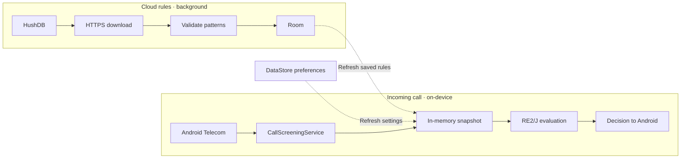

# Inside Hush

[Back to Hush](../README.md) · [User guide](https://hush.arpanm.xyz/docs) · [Privacy policy](https://hush.arpanm.xyz/privacy)

Hush has two main paths. Android Telecom needs a timely screening decision, so the service reads a precompiled snapshot already in memory. Rule downloads and persistence happen separately.



## From an incoming call to History

[PromoCallScreeningService](../app/src/main/java/com/vertos/promoblocker/PromoCallScreeningService.kt) responds to eligible incoming calls from Android. [NumberEvaluator](../app/src/main/java/com/vertos/promoblocker/NumberEvaluator.kt) applies the current settings and compares the phone number against compiled patterns. If the snapshot is still loading or evaluation takes too long, a local watchdog lets the call through.

After a rejection response, Hush records the number, time, and reason and can post a quiet notification. Room retains up to 10,000 entries and History shows the latest 1,000. **Clear history** deletes the entries from Hush’s database. Android backup for this data is disabled. Android and your phone maker decide whether a declined call also appears in the system call log.

## Rules and optional feedback

[BlockerRepository](../app/src/main/java/com/vertos/promoblocker/BlockerRepository.kt) builds the snapshot from Room and DataStore. [CloudRules](../app/src/main/java/com/vertos/promoblocker/CloudRules.kt) can refresh the approved feed when Hush opens, when connectivity returns while the app is running, and through WorkManager. Android decides when background work runs. Saved rules stay available offline, and per-rule cloud preferences survive a successful refresh.

If the user enables phone-state access and notifications, [CallFeedback](../app/src/main/java/com/vertos/promoblocker/CallFeedback.kt) can ask about an answered incoming call from an unsaved number. **No** stores the choice locally. **Yes** creates an exact-number rule locally and queues a report with the exact-match pattern and a hashed, app-scoped device identifier. HushDB can publish the pattern after three distinct device IDs across at least two source IPs. These checks limit repeat reports. They do not attest physical devices.

Hush also checks for a different release version when the app opens and can link to the official download page.

## Build and test

Use JDK 17 and Android SDK Platform 35. Android Studio can configure the SDK, or you can set `ANDROID_HOME` or put `sdk.dir=/path/to/android-sdk` in an untracked `local.properties`.

```sh
git clone https://github.com/arpan-mandal/hush.git
cd hush
./gradlew testDebugUnitTest lintDebug assembleDebug
```

The debug APK is at `app/build/outputs/apk/debug/app-debug.apk`. The unit test report is at `app/build/reports/tests/testDebugUnitTest/index.html`. Tests cover number matching, screening responses, storage upgrades, notifications, and Compose interactions. Check carrier verification, call logs, and real call behavior on an Android phone because they depend on the device and network.

Locally built debug APKs use your own debug key. Android checks that the signing certificate matches when upgrading an installed copy. For the official APK and checksum, use [GitHub Releases](https://github.com/arpan-mandal/hush/releases/latest).

## Contribute

Start with [an issue](https://github.com/arpan-mandal/hush/issues) or open a pull request. For a call-blocking bug, include your Android version, phone model, Hush version, and relevant settings. Use a made-up number that matches the same pattern to keep real phone numbers private. New community rules go through [HushDB](https://hushdb.arpanm.xyz/).
